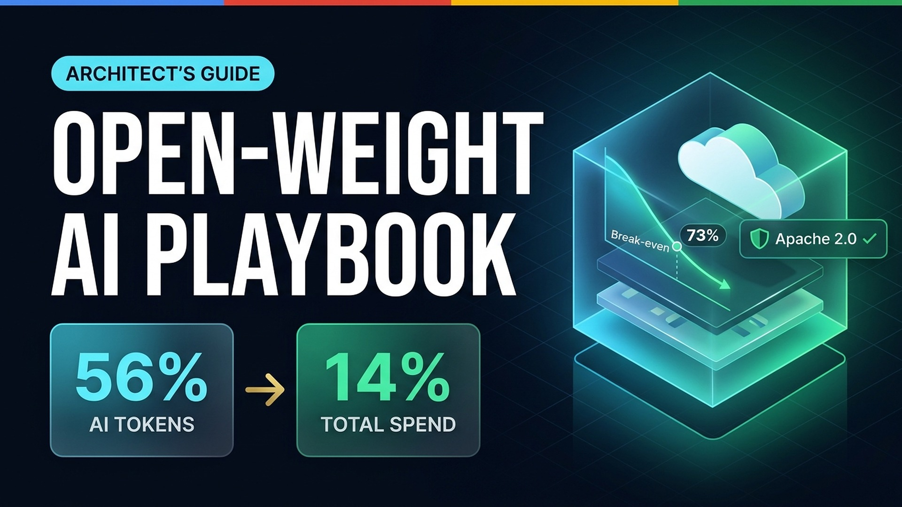
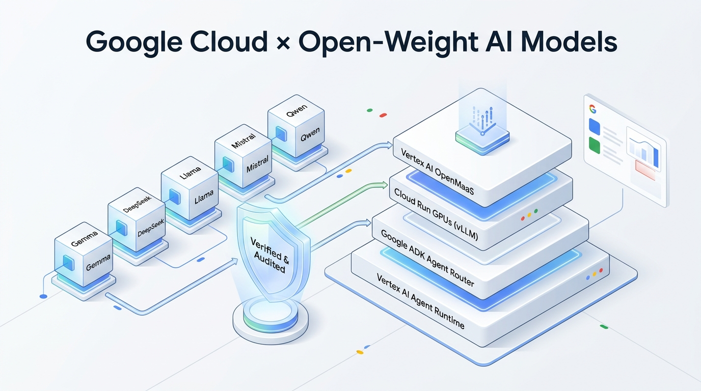

# Open-Weight AI Models — Unofficial Enterprise Architect's Playbook & Toolkit

An interactive enterprise architecture playbook, zero-dependency FinOps & license-triage calculator suite, and 7-part code series for evaluating, governing, and deploying open-weight AI models (`Gemma 4`, `Olmo 3`, `Qwen 3.8`, `DeepSeek-V4.1-Flash`, `Mistral Large 4`, and `System 1` decision heads) on [Google Cloud](https://cloud.google.com/vertex-ai). Open the live site in your browser with zero setup, or clone this repository to preview offline, edit the Markdown whitepaper, rebuild the single-file interactive bundle, and run the weekly series code starters.

[](https://github.com/kanchpat/open-weight-models/actions/workflows/pages.yml)
[](https://kanchpat.github.io/open-weight-models/)
[](https://youtu.be/jxbvqmRBcAo)
[](#disclaimer--attribution)
[](LICENSE)

> **✍️ Authored & Built by:** **Kanchana Patlolla** & **Anusha Sabbineni** · **With guidance from:** **Alan Blount**  
> **⚠️ Unofficial Google Guide Disclaimer:** Independent community & practitioner resource — **not** an officially supported Google product, official Google Cloud documentation, or legal advice. Views and FinOps estimates are strictly the authors' own ([full notice](#disclaimer--attribution)).

### ▶️ Prefer to Watch First? 5-Minute Enterprise Architect's Overview

[](https://youtu.be/jxbvqmRBcAo)

> **🎬 [Watch on YouTube (5:01)](https://youtu.be/jxbvqmRBcAo)** — Jump by chapter: [`0:00` 56% / 14% Shift](https://youtu.be/jxbvqmRBcAo?t=0) · [`0:40` Why Care](https://youtu.be/jxbvqmRBcAo?t=40) · [`1:11` License Traps](https://youtu.be/jxbvqmRBcAo?t=71) · [`1:56` ADK & System 1](https://youtu.be/jxbvqmRBcAo?t=116) · [`2:31` 73% GPU Rule](https://youtu.be/jxbvqmRBcAo?t=151) · [`3:12` 3 Live Calculators](https://youtu.be/jxbvqmRBcAo?t=192)

<details>
<summary><strong>🖼️ View Google Cloud × Open-Weight AI Reference Stack Overview</strong></summary>
<br>



</details>

## Table of Contents

- [Installation](#installation)
- [Usage](#usage)
- [Development](#development)
- [5 Key Architect Questions & Calculators](#5-key-architect-questions--calculators)
- [11 Open-Weight Model Families Covered](#11-open-weight-model-families-covered)
- [Repository Layout](#repository-layout)
- [Publishing](#publishing)
- [Troubleshooting](#troubleshooting)
- [Contributing](#contributing)
- [License](#license)
- [Disclaimer & Attribution](#disclaimer--attribution)

---

## Installation

**Option A — Zero-Install Browser App (fastest):**  
Open **[https://kanchpat.github.io/open-weight-models/](https://kanchpat.github.io/open-weight-models/)** directly in any browser. All infographics and calculators are bundled inline with zero external CDN requests.

**Option B — Clone Locally:**  
Requires `git` and **Python 3.10+** (Python standard library only — no `pip install` needed for the playbook or interactive toolkit):

```bash
git clone https://github.com/kanchpat/open-weight-models.git
cd open-weight-models
```

## Usage

Serve the self-contained interactive playbook and FinOps/licensing calculators locally:

```bash
python3 -m http.server 8000 --directory docs
```

Then open **`http://localhost:8000`** in your browser to:
- Filter all 11 open-weight model families by **corporate valuation cap (`$10B`), MAU cap (`100M–700M`), regional sovereignty, and pre-training data auditability** (`/licensing`).
- Model your **daily token volume and GPU cluster duty cycle** against the `73%` serverless vs. dedicated GPU break-even threshold (`/economics`).
- Map workloads across the **2×2 Sovereignty × Scale Architecture Router** and browse the 7-part code curriculum (`/series`).

To read the standalone whitepaper without launching a browser, open [`whitepaper/enterprise-playbook.md`](whitepaper/enterprise-playbook.md).

## Development

Edit [`whitepaper/enterprise-playbook.md`](whitepaper/enterprise-playbook.md) (playbook prose/tables) or [`scripts/build_github_pages.py`](scripts/build_github_pages.py) (calculators, model directory, and UI shell), then rebuild `docs/index.html` and start a local dev server:

```bash
git clone https://github.com/kanchpat/open-weight-models.git
cd open-weight-models

# Rebuild docs/index.html + series module indexes from whitepaper/enterprise-playbook.md
python3 scripts/build_github_pages.py
# -> Scaffolded repo files and README.
# -> Built 3-pane Claude-Docs-style GitHub Pages prototype at: .../docs/index.html

# Preview locally on port 8000
python3 -m http.server 8000 --directory docs
```

- **Prerequisites:** `git` and `Python >= 3.10` (`base64`, `html`, `os`, `re` from the standard library; zero third-party packages required to build or serve `docs/`).
- **Port:** Defaults to `http://localhost:8000` (pass any open port number to `http.server` if `8000` is in use).
- **Environment variables:** None required to build or run the interactive playbook. Individual hands-on labs under [`series/`](series/) document `GOOGLE_CLOUD_PROJECT` and `GOOGLE_CLOUD_LOCATION` as each Friday module unlocks.

---

## 5 Key Architect Questions & Calculators

Open-weight models now process **56% of enterprise gateway tokens at 14% of total spend**. Before downloading a checkpoint or reserving dedicated GPUs, the playbook walks through five architectural decisions:

1. **Release Tiers & Licensing (`§1–2` · `/licensing`):** Distinguish *open weights* (`Tier 3`) from *auditable open-source AI* (`Tier 4`), and filter out `$10B` valuation gates (`GLM-5.3`), `100M–700M` MAU cliffs (`Kimi K3`, `Llama 4`), and `CC BY-NC` adapters.
2. **Runtime Harnesses & `System 1` Heads (`§3–4.2` · `/drivers`):** Capture `+16.7pp` agent accuracy by evolving the harness in [Google ADK](https://google.github.io/adk-docs/) and `35×` faster, `200×` cheaper rubric checks with single-pass `System 1` decision heads (`output_tokens: 0`).
3. **Security, Sovereignty & Watch-Outs (`§4.3` · `/drivers`):** Mitigate `$1,200` weight abliteration, quantization tool-call drift, and shadow checkpoints via `SHA-256` pinning in [Artifact Registry](https://cloud.google.com/artifact-registry), VPC isolation, and [Model Armor](https://cloud.google.com/security-command-center/docs/model-armor-overview).
4. **Industry Patterns (`§5` · `/patterns`):** Inspect five production blueprints deployed by **Netflix (`GenRec`)**, **Pinterest**, **Harvey**, **DoorDash**, and **Coinbase & Uber**.
5. **The `73%` FinOps Rule (`§6–7` · `/economics`):** Calculate why dedicated self-hosted GPUs cost `1.42×` more than serverless [Vertex AI Model Garden](https://cloud.google.com/model-garden) PayGo (`$0.907/1M` tokens) below a `73%` duty cycle—and when to graduate to [Cloud Run GPUs](https://cloud.google.com/run/docs/configuring/services/gpu) (`vLLM` + `QAT`) or Vertex AI Agent Runtime.

## 11 Open-Weight Model Families Covered

| Model Family | Openness Tier | License & Governance | Enterprise Sweet Spot | Google Cloud Blueprint Surface |
| :--- | :--- | :--- | :--- | :--- |
| **Google `Gemma 4` (`31B`, `26B-A4B`, `E4B`, `MedGemma`)** | **Tier III** (Open Recipe + QAT) | 🟢 `Apache 2.0` | Zero tool-call drift under `FP4`/`INT4` QAT; `<150 ms` teacher-student distillation target | Vertex AI OpenMaaS · Cloud Run `vLLM` · ADK |
| **Ai2 `Olmo 3` (`32B Think`) & `Tülu 3`** | **Tier IV** (100% Open Source) | 🟢 `Apache 2.0` / `OpenMDW` | Full pre-training corpus (`Dolma 3`) + RLVR code for EU AI Act & copyright auditability | Vertex AI Model Garden · Agent Runtime VPC |
| **`DeepSeek-V4.1-Flash` (`1017`)** | **Tier III** (Open Weights) | 🟢 `MIT` | `763B` total / `8B–16B` active MoE with `CSA2` (`437×` KV-cache cut; `76×` lower coding cost) | Vertex AI OpenMaaS · ADK Tiered Router |
| **Alibaba `Qwen 3.8` (`27B` & `Flash-Next 180B-A6B`)** | **Tier III** (Open Weights) | 🟢 `Apache 2.0` | High-throughput multilingual & coding workhorse; vision encoder graft base (*Pattern 2*) | Vertex AI OpenMaaS · Cloud Run GPUs |
| **Mistral `Large 4` (`1T/52B`) & `Timestral`** | **Tier III** (Open Weights) | 🟢 `Apache 2.0` / `Mod-MIT` | `93.3%` Lakera B3 adversarial safety defense; `Timestral` zero-shot forecasting (`5,000` series/s) | Vertex AI Model Garden · Cloud Run `vLLM` |
| **Reflection AI `Beam 1.0` (`501B-A23B`)** | **Tier III** (Open Weights) | 🟢 `Apache 2.0` | US-origin frontier Sparse MoE (`501B` total / `23B` active) for multi-step agentic workflows | Vertex AI Model Garden · Agent Runtime |
| **Aleph Alpha `Kolibri` (`78B-A3.5B` MoE)** | **Tier IV** (Sovereign Verified) | 🟢 `Apache 2.0` | European sovereign MoE with cryptographic citation verification (`44%` abstention) | Vertex AI Agent Runtime (EU Sovereign VPC) |
| **`System 1` Decision Models (`dgem`, `Clef`, `Clairic`, `Decision-1`)** | **Tier III** (Single-Pass Heads) | 🟢 `Apache 2.0` | `0.6B–4B` single forward pass (`output_tokens: 0`); `35×` faster (`5.8–84 ms`) & `200×` cheaper triage | Google ADK Gate · Cloud Run · Agent Runtime |
| **Meta `Llama 4` (`Maverick` / `Scout`)** | **Tier III** (Threshold License) | 🟡 `700M MAU Cap` | Multimodal native MoE (`17B` active); requires `"Llama"` naming prefix & commercial deal `>700M` MAU | Vertex AI Model Garden |
| **Moonshot `Kimi K3.1 Pro` & `K3`** | **Tier III** (Threshold License) | 🟡 `100M MAU / $20M Cap` | Long-horizon deep-research MoE; requires custom commercial license above `100M` MAU | Self-Hosted `vLLM` on GKE / Cloud Run |
| **Zhipu `GLM-5.3-Flash` (`320B-A18B`)** | **Tier III** (Valuation Gate) | 🔴 `$10B Valuation Cap` | Fast agentic coding, but triggers mandatory commercial & security gate if valuation `>= $10B` | Requires Commercial Gate Clearance |

## Repository Layout

```text
open-weight-models/
├── README.md                                   # Quick start, usage, model index & governance notes
├── LICENSE                                     # Apache License 2.0
├── CONTRIBUTING.md                             # Workflow for updating models, pricing & calculators
├── .github/workflows/pages.yml                 # Automated GitHub Pages deployment on push to main
├── docs/                                       # Published GitHub Pages bundle (zero external CDNs)
│   ├── index.html                              # Generated interactive playbook + FinOps calculators
│   ├── .nojekyll                               # Serves static assets verbatim on GitHub Pages
│   └── assets/                                 # Source architecture diagrams & hero artwork
├── whitepaper/
│   └── enterprise-playbook.md                  # Canonical Markdown source of the Enterprise Playbook
├── scripts/
│   └── build_github_pages.py                   # Compiles whitepaper + assets into docs/index.html
└── series/                                     # 7-Part Weekly Code & Video Series (Nov–Dec 2026)
    ├── part-02-openmaas-serverless/            # Nov 13: Zero-Ops OpenMaaS Serverless Agents ($0.907/1M)
    ├── part-03-adk-harness-system1/            # Nov 13: ADK Multi-Model Routing & System 1 Rubric Gates
    ├── part-04-cloudrun-vllm-qat/              # Nov 20: Scale-to-Zero vLLM & Gemma 4 QAT on Cloud Run GPUs
    ├── part-05-agent-runtime-vpc/              # Nov 20: Sovereign In-VPC Agents & Guardrails on Agent Runtime
    ├── part-06-lora-grpo-verifiable-rl/        # Dec 04: LoRA, <$100 Single-GPU GRPO RL & Multi-LoRA
    └── part-07-frontier-distillation/          # Dec 11: Gemini 3.1 Pro -> Gemma 4 Distillation (<150 ms TTFT)
```

## Publishing

Maintainers deploy updates automatically to GitHub Pages via [`.github/workflows/pages.yml`](.github/workflows/pages.yml) (no npm, PyPI, or container registry publish step applies to the documentation hub):

```bash
python3 scripts/build_github_pages.py
git add whitepaper/enterprise-playbook.md scripts/build_github_pages.py docs/index.html series/
git commit -m "docs: update playbook and rebuild GitHub Pages bundle"
git push origin main
```

Every push to `main` packages `docs/` as a Pages artifact and deploys live to **`https://kanchpat.github.io/open-weight-models/`** in ~25 seconds.

## Troubleshooting

- **Edits to `docs/index.html` disappeared after rebuild:** `docs/index.html` is compiled output. Edit [`whitepaper/enterprise-playbook.md`](whitepaper/enterprise-playbook.md) or [`scripts/build_github_pages.py`](scripts/build_github_pages.py) and re-run `python3 scripts/build_github_pages.py`.
- **Browser still shows an older build:** Because `docs/index.html` embeds Base64 diagrams into a single `~6.4 MB` HTML artifact, hard-refresh with **`Cmd + Shift + R`** (macOS) or **`Ctrl + Shift + R`** (Windows/Linux) after rebuilding or deploying.
- **`OSError: [Errno 98] Address already in use` on port `8000`:** Pass another free port, e.g. `python3 -m http.server 8080 --directory docs`.

## Contributing

Pull requests and issues are welcome—especially for newly released open-weight models, updated commercial/MAU license thresholds, FinOps pricing shifts, and public enterprise case studies. For major structural changes, please [open an issue](https://github.com/kanchpat/open-weight-models/issues) first to discuss scope.

See [`CONTRIBUTING.md`](CONTRIBUTING.md) for the edit → `build_github_pages.py` → local preview workflow.

## License

Licensed under the **Apache License 2.0** — see [`LICENSE`](LICENSE) for full terms. *(Note: individual third-party open-weight models referenced in this guide carry their own upstream licenses as documented in `§2`.)*

## Disclaimer & Attribution

- **Authors & Contributors:** Authored and built by **Kanchana Patlolla** and **Anusha Sabbineni**, with guidance from **Alan Blount**.
- **Unofficial Google Guide:** This repository (`kanchpat/open-weight-models`) and companion website (`kanchpat.github.io/open-weight-models`) are an **unofficial community & practitioner guide**. **This is not an officially supported Google product**, nor is it an official Google or Google Cloud publication, documentation set, or endorsement.
- **No Legal or Financial Advice:** All opinions, architectural recommendations, FinOps cost estimates, and model licensing summaries are strictly the authors' own and are provided *as-is* for informational planning only. Always consult qualified legal counsel before deploying open-weight models in commercial production.
