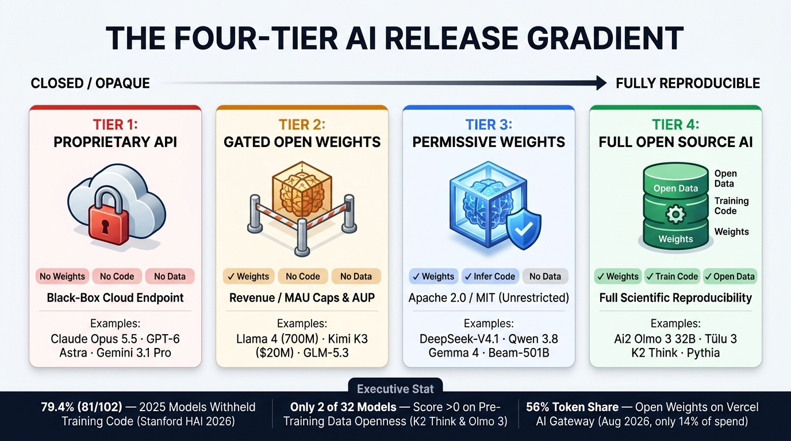
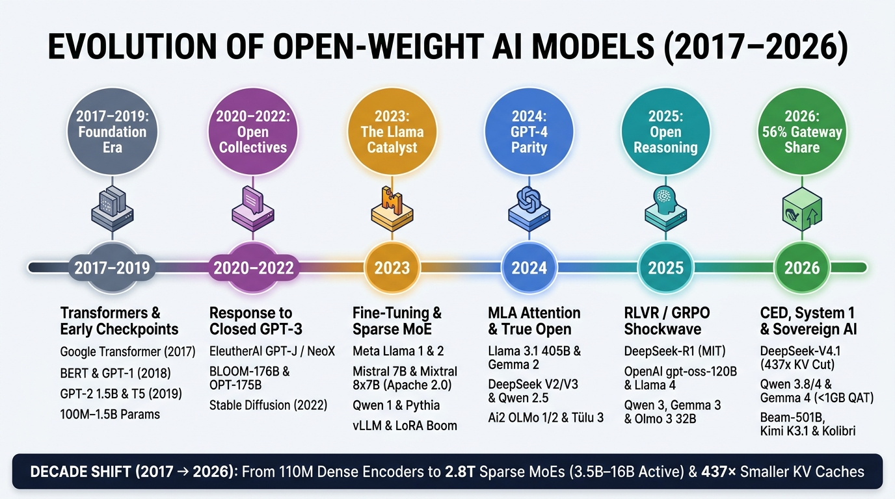
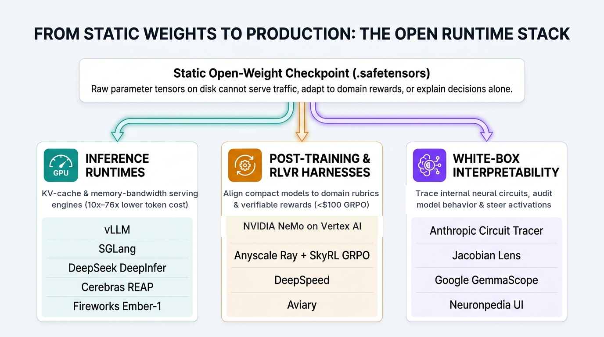
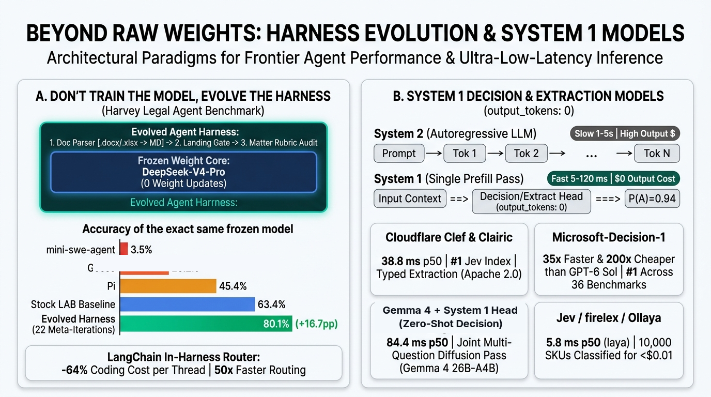

# Open-Weight AI Models for the Enterprise: An Architect's Guide to Strategy, Economics & Production Patterns

**Authored & Built by:** Kanchana Patlolla & Anusha Sabbineni · **With guidance from:** Alan Blount  
*Unofficial Google Cloud Practitioner Guide · Companion Playbook to the 7-Part Code & Video Series*

> **⚠️ Unofficial Guide Disclaimer:** This playbook and companion website are an **unofficial practitioner guide** created to help enterprise architects evaluate open-weight AI models. This is **not** an official Google or Google Cloud publication, product documentation, endorsement, or an officially supported Google product. All views, architectural patterns, FinOps cost models, and licensing summaries (for informational planning only, not legal advice) are strictly the authors' own.

> **Why Read This Guide? (For Enterprise Architects Considering Open Weights)**
>
> Open-weight AI models now process **56% of production gateway tokens** while accounting for just **14% of total spend** ([Vercel AI Gateway Index, Sept 2026](https://vercel.com/blog/ai-gateway-production-index-september-2026)). If you are an **Enterprise Architect, Platform Lead, or AI Engineering Leader** evaluating whether—and how—to bring open weights into your production stack alongside closed frontier APIs, this guide answers the core architectural questions you need to resolve first:
> - **What are you actually downloading?** Why "open weights" (`customizable binary`) is different from "open source" (`weights + code + auditable training data`), and how to avoid hidden valuation, MAU, and non-commercial adapter traps.
> - **What drives real enterprise ROI—and what can go wrong?** How to capture **`10×–76×` lower token costs**, **in-VPC data sovereignty**, **agent harness gains (`+16.7pp`)**, and **single-pass `System 1` speed (`35×` faster)** while mitigating **Day-2 MLOps overhead**, **`$1,200` weight abliteration**, and **quantization drift**.
> - **When does self-hosting actually beat serverless PayGo?** Why dedicated GPUs cost **`1.42×` more** than managed serverless endpoints below a **`73%` hardware duty cycle**, and how to route workloads across five battle-tested **Patterns from the Field**.
> - **How to build this on Google Cloud:** Throughout this series, we will follow up each architectural layer in this guide with hands-on **Google Cloud code blueprints, notebooks, and video walkthroughs**.

## 1. Open Weights vs. Open Source: The 4 Release Tiers

In traditional software, open source gives you the source code to inspect and rebuild the program from scratch. In AI, **79.4% of notable models withhold their training data and training code** ([Stanford HAI 2026](https://hai.stanford.edu/assets/files/ai_index_report_2026.pdf)). Downloading **open weights** gives your team a **customizable binary**—you can self-host and fine-tune it inside your VPC, but you cannot audit its training data unless you choose a **Tier 4 Full Open-Source** model.

| Release Tier | What You Get | Representative Models | Best Enterprise Fit |
| :--- | :--- | :--- | :--- |
| **Tier 1 — Closed Frontier APIs** | Hosted API only (no weights or data) | `Gemini 3.1 Pro`, `Claude Opus 5.5`, `GPT-6 Astra` | Low/spiky traffic (`<20%` GPU duty cycle), rapid prototyping, and PhD-level zero-shot R&D |
| **Tier 2 — Restricted / Gated Weights** | Downloadable weights with **revenue, valuation, or MAU caps** | `Meta Llama 4`, `Moonshot Kimi K3`, `Zhipu GLM-5.3`, `MiniMax M3` | Internal tools and mid-scale workloads that stay safely below commercial cap thresholds |
| **Tier 3 — Permissive Open Weights (`Apache 2.0` / `MIT`)** | Unrestricted commercial weights + inference code (training data undisclosed) | `Google Gemma 4`, `Alibaba Qwen 3.8`, `DeepSeek-V4.1-Flash`, `Mistral Large 4`, `Beam-1.0-501B` | **Default enterprise workhorse** for commercial SaaS, customer agents, and domain fine-tuning |
| **Tier 4 — Reproducible Open-Source AI** | **Weights + Training Code + Auditable Pre-Training Data** | `Ai2 Olmo 3 (32B Think)`, `Tülu 3`, `Aleph Alpha Kolibri`, `NVIDIA Nemotron 3` | Regulated banking, healthcare, and public sector requiring full training-data provenance |

## 2. Procurement & Licensing Triage

### 2.1 Navigating the Three Broad Licensing Classifications

Before deploying a checkpoint, enterprise architecture and legal teams sort "open" models into three traffic-light buckets—and evaluate them against **company valuation**, **product MAU scale**, **regional sovereignty**, and **pre-training data auditability**:

| Licensing Classification | Procurement Status | Commercial Rights & Legal Watch-Outs | Representative Models & Thresholds |
| :--- | :--- | :--- | :--- |
| **1. Permissive Open-Source** (`Apache 2.0`, `MIT`, `OpenMDW`) | **🟢 Green — Default Approved** | Unrestricted rights to self-host, fine-tune, distill, and commercialize at any scale. **`Apache 2.0`** includes an explicit patent grant; **`OpenMDW`** covers weights, data, and code. | **[Google `Gemma 4`](https://docs.cloud.google.com/gemini-enterprise-agent-platform/models/open-models/use-gemma)**, **Alibaba `Qwen 3.8`**, **[Reflection `Beam-1.0-501B`](https://reflection.ai/blog/introducing-beam)**, **[Aleph Alpha `Kolibri`](https://aleph-alpha.com/en/blog/kolibri-has-landed-a-sovereign-open-weight-model/)**, **[Cloudflare `Clef`](https://blog.cloudflare.com/clef-decision-models/)** (`Apache 2.0`); **[`DeepSeek-V4.1-Flash`](https://arxiv.org/pdf/2609.19969)** (`MIT`); **[`Ai2 Olmo 3`](https://arxiv.org/abs/2512.13961)** (`OpenMDW`) |
| **2. Commercial-Capped Custom Licenses** | **🟡 Amber — Legal Gate Above Cap** | Free for R&D, but enforces **revenue, corporate valuation, or MAU cliffs**, mandatory naming prefixes, and Acceptable-Use Policies (AUPs). | **`Zhipu GLM-5.3`** (**\$10B corporate valuation/revenue** gate); **`Kimi K3`** & **`Muse Spark Open`** (**\$20M/mo** rev or **100M MAU**); **`MiniMax M3`** (**\$20M/yr**); **`Llama 4`** (**700M MAU** + `"Llama"` prefix) |
| **3. Split-Artifact & Non-Commercial Adapters** | **🔴 Red / Amber — Audit Required** | Code repo is `MIT`/`Apache 2.0`, but the **weights** or **LoRA adapters** carry restrictive or non-commercial (`CC BY-NC`) terms. | **[Mistral `Timestral`](https://github.com/mistralai/timestral)** (`Apache 2.0` code vs. **Modified MIT** weights); **[`firelex/jeff`](https://github.com/firelex/jeff)** (`sanctions` & `soc` LoRAs restricted to **`CC BY-NC 4.0` Non-Commercial**) |

## 3. The 2026 Model Landscape & 3-Layer Production Stack

### 3.1 Picking the Right Open-Weight Model Family

| Enterprise Workload | Top Open-Weight Picks (2026) | License | Why It Wins |
| :--- | :--- | :--- | :--- |
| **General Agents, Multimodal & Edge QAT** | **[Google `Gemma 4`](https://docs.cloud.google.com/gemini-enterprise-agent-platform/models/open-models/use-gemma)** (`31B`, `26B-A4B`, `E4B`) & **Alibaba `Qwen 3.8`** (`27B`, `Flash-Next`) | `Apache 2.0` | Native Quantization-Aware Training ([`Gemma 4` QAT](https://blog.google/innovation-and-ai/technology/developers-tools/quantization-aware-training-gemma-4/)), `<1 GB` edge footprint, and drop-in Vertex AI / ADK support |
| **Long-Context Coding & Repository RAG** | **[`DeepSeek-V4.1-Flash`](https://arxiv.org/pdf/2609.19969)** (`763B` total / `8B–16B` active) & **[`Kimi K3.1 Pro`](https://www.kimi.ai/blog/kimi-k3-1-pro)** | `MIT` / Custom | `437×` smaller KV cache (`890 B/tok`), `1M` context window, and `76×` lower multi-turn coding session cost |
| **US / EU Sovereign & Regulated Workloads** | **[Reflection `Beam-1.0-501B`](https://reflection.ai/blog/introducing-beam)** (US) & **[Aleph Alpha `Kolibri`](https://aleph-alpha.com/en/blog/kolibri-has-landed-a-sovereign-open-weight-model/)** (`78B/3.5B`, EU) | `Apache 2.0` | Western-origin checkpoints; `Kolibri` adds Merlin-Arthur verified grounding (`44%` hallucination abstention) |
| **100% Auditable Training Provenance** | **[Ai2 `Olmo 3 (32B Think)`](https://arxiv.org/abs/2512.13961)** & **[`Tülu 3`](https://arxiv.org/abs/2411.15124)** | `Apache 2.0` / `OpenMDW` | Full public release of pre-training data, filtering code, and post-training recipes |
| **High-QPS Classification & Extraction (`output_tokens: 0`)** | **[Cloudflare `Clef` & `Clairic`](https://blog.cloudflare.com/clef-decision-models/)**, **[`Microsoft-Decision-1`](https://commandline.microsoft.com/microsoft-decision-1-model-foundry/)**, **`Gemma 4` System 1** | `Apache 2.0` | Single-forward-pass calibrated probabilities (`5–85 ms` p50) at **`35×` lower latency and `200×` lower cost** |

### 3.2 The Three-Layer Open Production Stack

Raw `.safetensors` weights on disk are not a production service. Turning open weights into an enterprise platform requires three runtime layers—**all of which we will build and deploy step-by-step on Google Cloud in our companion Code & Video Series**:

1. **Inference Runtimes (`vLLM`, `SGLang`, `DeepInfer`):** Maximize GPU memory bandwidth via PagedAttention, prefix caching, and disaggregated prefill/decode (`>25,000 tok/s/GPU`). *(Covered in Series Parts 2 & 4 on Vertex AI OpenMaaS and Cloud Run GPUs).*
2. **Post-Training & Verifiable RL (`Vertex AI Training`, `Ray` + `SkyRL GRPO`):** Align compact `7B–32B` models to deterministic domain rubrics and unit tests, often on a single GPU for `<$100`. *(Covered in Series Parts 6 & 7 on LoRA, Verifiable RL, and Distillation).*
3. **White-Box Governance & Guardrails (`Circuit Tracer`, `GemmaScope`, `Model Armor`):** Inspect internal neural circuits, enforce `System 1` rubric gates, and clamp unsafe activations prior to rollout. *(Covered in Series Parts 3 & 5 on ADK and Vertex AI Agent Runtime).*

## 4. Enterprise Drivers: Strategic Value, Runtime Levers & Watch-Outs

When architecting an open-weight strategy, leaders must weigh **four strategic value drivers** and **two high-ROI runtime levers** against **seven operational watch-outs**.

### 4.1 Four Strategic Value Drivers

1. **FinOps & Margin Protection (`10×–76×` Lower Token Cost):** Compressing KV-cache memory (`437×` on [`DeepSeek-V4.1-Flash`](https://arxiv.org/pdf/2609.19969)) drops a 447-turn coding session from **\$55.00 (`GPT-6 Astra`) to \$0.72 (`76×` cheaper)**; [Cloudflare](https://blog.cloudflare.com/obsessive-inference-optimization) cut its production inference bill **68%** with open weights and quantization.
2. **In-VPC Data Sovereignty & `SHA-256` Audit Pinning:** Self-hosting keeps PII, source code, and M&A documents inside your private VPC with **zero external egress**, while pinning an immutable **`SHA-256` checkpoint hash** prevents silent vendor API updates from breaking FDA, FINRA, or EU AI Act audits.
3. **Defensible Domain Moats:** Prompting a shared closed API builds zero moat. Open weights let teams graft proprietary domain encoders (*Pattern 2*), attach prefill-only ranking heads (*Pattern 1*), and run **`<$100` single-GPU Verifiable RL (`GRPO`)** (*Pattern 5*).
4. **White-Box Circuit Auditing:** Safety teams can attach **[Anthropic `Circuit Tracer`](https://github.com/safety-research/circuit-tracer)** and **Google `GemmaScope` + [`Neuronpedia`](https://www.neuronpedia.org/)** directly to internal layers to trace and clamp hallucinations before deployment.

### 4.2 High-ROI Runtime Drivers: Evolving the Harness & `System 1` Models

Before spending compute to retrain model weights, enterprise architects can unlock massive accuracy and latency gains in the **runtime harness layer**:

- **"Don't Train the Model, Evolve the Harness" (`+16.7pp` Accuracy, `-64%` Cost):** Keeping `DeepSeek-V4-Pro` completely frozen on **Harvey's Legal Agent Benchmark (LAB)**, generic coding scaffolds scored `3.5%–45.4%` and the stock baseline scored `63.4%`. Evolving only the surrounding harness ([Niklaus, 2026](https://huggingface.co/spaces/joelniklaus/harness-optimization); [Meta-Harness](https://arxiv.org/abs/2603.28052))—adding `.docx`/`.xlsx` parsers and pre-submission rubric gates—lifted unseen test accuracy **`+16.7pp` to `80.1%`**, while in-harness model routing ([LangChain `Open SWE`](https://www.langchain.com/blog/how-to-build-a-model-router-in-the-harness)) cut median coding thread cost **64%**.
- **`System 1` Single-Pass Decision Models (`output_tokens: 0`, `35×` Faster, `200×` Cheaper):** High-volume ticket routing, guardrails, fraud scoring, and field extraction do not need slow token-by-token essays (`System 2`). **System 1 models** ([TypeSafe `Jev`](https://typesafe.ai/blog/introducing-system-one-models-and-jev), [Cloudflare `Clef` & `Clairic`](https://blog.cloudflare.com/clef-decision-models/), [`Microsoft-Decision-1`](https://commandline.microsoft.com/microsoft-decision-1-model-foundry/), `Gemma 4` Decision Heads) evaluate the prompt in **one parallel forward pass (`output_tokens: 0`)** in `5.8–84 ms` p50.

### 4.3 Seven Enterprise Watch-Outs & How to Mitigate Them

| Risk Category | What Goes Wrong in Production | Concrete Architectural Mitigation |
| :--- | :--- | :--- |
| **1. Idle GPU Burn (`<73%` Duty Cycle)** | Dedicated 24/7 GPU endpoints sit idle nights/weekends, costing `1.42×` more than serverless PayGo. | Default to **Vertex AI OpenMaaS PayGo (`$0.907/1M`)** or **Cloud Run Scale-to-Zero GPUs** until utilization exceeds **73%**. |
| **2. Zero Vendor IP Indemnification** | Raw Hugging Face checkpoints (`AS-IS`) provide zero legal defense if undisclosed training data triggers a copyright claim. | Consume open models via **indemnified cloud endpoints (Vertex AI Model Garden)** or require **Tier 4 auditable models (`Olmo 3`, `Kolibri`)**. |
| **3. Hidden License Cliffs & NC Adapters** | `GLM-5.3` triggers a commercial gate at **\$10B valuation**; `Kimi K3` at **\$20M/mo** or **100M MAU**; `firelex/jeff` `sanctions` LoRAs are **`CC BY-NC`**. | Enforce an internal **Model Registry allowlist** defaulting to verified `Apache 2.0`, `MIT`, or `OpenMDW` artifacts. |
| **4. \$1,200 Weight Abliteration & Prefill Attacks** | Weight-space safety removal costs just **`$1,200`** (`>90%` $\rightarrow$ `2%` refusal; [Anthropic/NIST](https://www.anthropic.com/research/glm-5-3-and-the-spread-of-advanced-cyber-capabilities)), and assistant prefill bypasses alignment **92%** of the time. | Never rely on model weights alone for safety: disable assistant prefill and wrap endpoints in **System 1 guardrails (`Clef`)** + **Model Armor**. |
| **5. Frontier Science & Quantization Drift** | Open models trail closed APIs by `~3–4 months` on PhD science (`CritPt v2`), and naive `INT4` quantization breaks multi-turn tool calling. | Keep hard zero-shot R&D on `Gemini 3.1 Pro` / `Claude Opus 5.5`, and use **Quantization-Aware Trained (`QAT`)** checkpoints (`Gemma 4`). |
| **6. Geopolitical Origin Vetoes** | US Defense/FedRAMP and regulated financial boards frequently restrict foreign-origin weights even inside air-gapped VPCs. | Standardize regulated workloads on **US/EU-origin open weights** (`Gemma 4`, `Beam-1.0-501B`, `Olmo 3`, `Mistral Large 4`, `Kolibri`). |
| **7. The 6-Week Checkpoint Treadmill** | Custom LoRAs and grafted encoders lock you to one base checkpoint that gets leapfrogged 6 weeks later. | Invest in **model-agnostic Agent Harnesses (`ADK`) first**, and automate `<$100` `GRPO` post-training pipelines so base swaps take hours. |

## 5. Industry Patterns: Real-World Production Deployments

Across streaming, visual commerce, legal tech, logistics, and fintech, leading enterprises have converged on **five reusable industry patterns** for deploying open-weight models in production:

| Industry Pattern & Customer | Enterprise Bottleneck | Open-Weight Architecture Blueprint | Verified Production ROI |
| :--- | :--- | :--- | :--- |
| **1. Prefill-Only Catalog Ranker** **[Netflix (`GenRec`)](https://netflixtechblog.com/genrec-towards-llm-native-recommendation-at-netflix-f20be6f643e3)** · *Media & Streaming* | Autoregressive token decoding is too slow for real-time catalog ranking across millions of concurrent users. | Verbalize user history into text and attach a **linear catalog scoring head** served on **`vLLM` in prefill-only mode (`output_tokens: 0`)**. | Statistically significant engagement lift across **~10% of global Netflix traffic** at sub-second latency. |
| **2. Surgical Vision Encoder Graft** **[Pinterest](https://www.youtube.com/watch?v=1C3HLLWtOx0)** · *Visual Commerce* | Closed multimodal APIs are too expensive at high discovery QPS and lack proprietary catalog visual context. | Post-train an open VLM (`Qwen3-VL` / `Gemma 4`) and **replace its generic vision tower with Pinterest's pre-computed visual embeddings**. | **90% lower serving cost** than closed proprietary APIs with higher visual search relevance. |
| **3. Matter-Isolated Rubric Gates** **[Harvey](https://www.harvey.ai/blog/introducing-harveys-legal-agent-benchmark)** · *Legal & Regulated Advisory* | Global law firms require strict client-matter data isolation and adherence to complex multi-part partner rubrics. | Post-train open weights across **`75,000+` legal rubric criteria** (`LegalAgentBench`) and enforce pre-submission **harness verification gates**. | **Nearly `2×` strict all-pass rate** (`+16.7pp` from harness gates alone) with dedicated model ownership. |
| **4. Teacher-Student SKU Distillation** **[DoorDash](https://careersatdoordash.com/blog/unleashing-the-power-of-large-language-models-at-doordash-for-a-seamless-shopping-adventure/)** · *Logistics & Retail* | Labeling millions of catalog SKUs and triaging delivery defect photos on frontier APIs is too slow and costly. | Use a frontier teacher (`Gemini 3.1 Pro`) to label domain pairs, then distill into **quantized `LoRA`/`QLoRA` open student models on Ray**. | **`10×` lower serving cost** at **`<150 ms` TTFT**; training turnaround cut from weeks to days. |
| **5. Sub-\$100 Verifiable RL & Gateway** **[Coinbase](https://www.coinbase.com/blog/part-one-how-coinbase-built-evaluated-and-post-trained-a-fraud-agent)** & **[Uber](https://www.uber.com/us/en/blog/genai-gateway/)** · *Fintech & Platforms* | Frontier APIs miss domain-specific fraud patterns and cannot receive unredacted customer PII at high QPS. | Post-train a **`9B` open model** with **single-GPU `GRPO` (`SkyRL`) for `<$100`** (Coinbase) behind a **PII-redacting GenAI Gateway (`16M` queries/mo, Uber)**. | **`+9.6%` F1 over frontier APIs**, **55% lower latency**, and **30% reduction in live production fraud**. |

## 6. Unit Economics & Workload Routing Toolkit

### 6.1 The 73% Duty-Cycle Rule: Serverless OpenMaaS vs. Dedicated GPUs
- **Why Dedicated Self-Hosting Often Costs More on Day 1:** Serverless APIs charge **\$0 when idle**, whereas dedicated self-hosted GPUs burn budget 24/7. Benchmark economics show that self-deploying **`Gemma 4 26B`** on a dedicated endpoint at typical enterprise utilization (`~51%` duty cycle) costs **`$1.29/1M` tokens—`1.42×` more than managed Vertex AI OpenMaaS PayGo (`$0.907/1M`)**.
- **The Two Break-Even Thresholds:** (1) Moving from closed frontier APIs to open weights via **managed OpenMaaS** pays off at **`8M–30M tokens/day`** (`60%–90%` savings). (2) Moving from managed OpenMaaS to **dedicated 24/7 self-hosted GPUs** only breaks even above a **`73%` sustained hardware duty cycle** with a 3-year reservation.
- **Enterprise Mitigation:** Start on **Vertex AI Model Garden OpenMaaS** (`$0` idle burn) or **Cloud Run scale-to-zero GPUs** (`vLLM` containers) before reserving dedicated clusters.

### 6.2 Interactive Workload & Architecture Router

Rather than treating AI as a binary choice between closed APIs and self-hosted open models, enterprise architects map each workload across two axes: **Production Token Velocity / Duty Cycle** and **Data Sovereignty / Customization Need**. Use the interactive router below to select your workload profile and inspect the recommended reference architecture:

## 7. Ready to Start on Google Cloud? Watch This Space

We are turning every architectural pattern in this playbook into runnable code, deployment templates, and short video walkthroughs on **Google Cloud**. **Watch this space** as we release each hands-on module:

1. **Start Serverless on Vertex AI OpenMaaS:** Launch zero-ops open-weight endpoints (`Gemma 4`, `Qwen 3.8`, `DeepSeek-V4.1-Flash`) in **[Vertex AI Model Garden](https://docs.cloud.google.com/gemini-enterprise-agent-platform/models/open-models/use-gemma)** with `$0` idle GPU burn and enterprise IP indemnification.
2. **Evolve Your Agent Harness with ADK & `System 1` Gates:** Build multi-model routers combining `Gemini 3.1 Pro` and open weights in the **[Agent Development Kit (ADK)](https://adk.dev/agents/models/google-gemma/)** with single-pass **`System 1` rubric verification gates**.
3. **Deploy Scale-to-Zero `vLLM` on Cloud Run & Sovereign Agents on Agent Runtime:** Run bursty custom `vLLM` and Quantization-Aware Trained (`QAT`) containers on **Cloud Run GPUs**, or lock down air-gapped `SHA-256`-pinned weights on **Vertex AI Agent Runtime** with **Model Armor**.
4. **Customize with `LoRA`, `<$100` Verifiable RL (`GRPO`) & Distillation:** Replace 10,000-token prompts with parameter-efficient `LoRA`/`QLoRA`, single-GPU `GRPO` reinforcement learning, and **Teacher-Student Distillation (`Gemini 3.1 Pro` → `Gemma 4`)** on **Vertex AI**.

> 🔔 **Watch This Space:** Bookmark this repository and follow along via the **7-Part Code & Video Series** tab above as new Google Cloud notebooks, `vLLM` Dockerfiles, and video demos go live!

## 8. Reference Appendices & Primary Source Bibliography

### 8.1 Key Primary Sources (`[1]`–`[20]`)
- **[1]** Nathan Lambert. *Open Models and Their Role in an AI Ecosystem* (Harvard CS 2881R, Oct 2026). [Slides](https://natolambert.com/slides/2026/harvard/lecture.html#29)
- **[2]** Stanford HAI. *The 2026 AI Index Report* (2026). [PDF](https://hai.stanford.edu/assets/files/ai_index_report_2026.pdf)
- **[3]** Irene Solaiman. *The Gradient of Generative AI Release*. `arXiv:2302.04844`. [arXiv](https://arxiv.org/abs/2302.04844)
- **[4]** Vercel. *AI Gateway Production Index: September 2026 — Open-Weight Models Take 56% of Token Volume*. [Blog](https://vercel.com/blog/ai-gateway-production-index-september-2026)
- **[5]** Team Olmo (Ai2). *Olmo 3 32B Think (`arXiv:2512.13961`)* & *Tülu 3 (`arXiv:2411.15124`)*. [Olmo 3](https://arxiv.org/abs/2512.13961) | [Tülu 3](https://arxiv.org/abs/2411.15124)
- **[6]** DeepSeek-AI. *DeepSeek-V4.1-Flash (`1017`): Causal Encoder-Decoder MoE with CSA2 (`arXiv:2609.19969`)*. [PDF](https://arxiv.org/pdf/2609.19969) | [`DeepInfer`](https://github.com/deepseek-ai/DeepInfer)
- **[7]** Google Cloud & DeepMind. *Use Gemma 4 Open Models on Vertex AI* & *Quantization-Aware Training (QAT)*. [Vertex AI Docs](https://docs.cloud.google.com/gemini-enterprise-agent-platform/models/open-models/use-gemma) | [QAT Blog](https://blog.google/innovation-and-ai/technology/developers-tools/quantization-aware-training-gemma-4/) | [ADK Docs](https://adk.dev/agents/models/google-gemma/)
- **[8]** Alibaba Qwen Team. *Qwen 3.8-27B & Flash-Next (`180B-A6B`)* (`Apache 2.0`, 2026). [Blog](https://qwen.ai/blog?id=qwen3.8-flash-next)
- **[9]** Mistral AI. *Mistral Large 4 (`Apache 2.0`)* & *Timestral*. [Large 4](https://mistral.ai/news/mistral-large-4) | [Timestral](https://github.com/mistralai/timestral)
- **[10]** Reflection AI. *Introducing Beam (`Beam-1.0-501B-A23B`, `Apache 2.0`)* (2026). [Blog](https://reflection.ai/blog/introducing-beam)
- **[11]** Aleph Alpha. *Kolibri: A Sovereign European Open-Weight Model (`Apache 2.0`)* (2026). [Blog](https://aleph-alpha.com/en/blog/kolibri-has-landed-a-sovereign-open-weight-model/)
- **[12]** Moonshot AI. *Kimi K3.1 Pro Tech Blog* & *Kimi K3 License*. [Blog](https://www.kimi.ai/blog/kimi-k3-1-pro) | [License](https://huggingface.co/moonshotai/Kimi-K3/blob/main/LICENSE)
- **[13]** Zhipu AI. *GLM-5.3-Flash* & *GLM-5.3 Commercial Cap License*. [Blog](https://z.ai/blog/glm-5.3-flash) | [License](https://huggingface.co/zai-org/GLM-5.3/blob/main/LICENSE)
- **[14]** Joel Niklaus (Hugging Face). *Don't Train the Model, Evolve the Harness (Harvey LegalAgentBench)* & Yoonho Lee et al. *Meta-Harness (`arXiv:2603.28052`)*. [HF Space](https://huggingface.co/spaces/joelniklaus/harness-optimization) | [arXiv](https://arxiv.org/abs/2603.28052)
- **[15]** LangChain Engineering. *How to Build a Model Router in the Harness* (2026). [Blog](https://www.langchain.com/blog/how-to-build-a-model-router-in-the-harness)
- **[16]** System 1 Decision & Extraction Models: [TypeSafe `Jev`](https://typesafe.ai/blog/introducing-system-one-models-and-jev) | [Cloudflare `Clef`](https://blog.cloudflare.com/clef-decision-models/) | [Cloudflare `Clairic`](https://blog.cloudflare.com/clairic-extraction-model) | [`Microsoft-Decision-1`](https://commandline.microsoft.com/microsoft-decision-1-model-foundry/) | [`firelex/jeff`](https://github.com/firelex/jeff)
- **[17]** Industry Patterns (Customer Engineering Blueprints): [Pattern 1 — Netflix `GenRec` Prefill Ranker](https://netflixtechblog.com/genrec-towards-llm-native-recommendation-at-netflix-f20be6f643e3) | [Pattern 2 — Pinterest Vision Encoder Graft](https://www.youtube.com/watch?v=1C3HLLWtOx0) | [Pattern 3 — Harvey LegalAgentBench](https://www.harvey.ai/blog/introducing-harveys-legal-agent-benchmark) | [Pattern 4 — DoorDash Teacher-Student Distillation](https://careersatdoordash.com/blog/unleashing-the-power-of-large-language-models-at-doordash-for-a-seamless-shopping-adventure/) | [Pattern 5 — Coinbase `<$100` GRPO Fraud Agent](https://www.coinbase.com/blog/part-one-how-coinbase-built-evaluated-and-post-trained-a-fraud-agent) & [Uber GenAI Gateway](https://www.uber.com/us/en/blog/genai-gateway/)
- **[18]** Anthropic Frontier Red Team & US NIST CAISI. *`GLM-5.3` and the Spread of Advanced Cyber Capabilities (Weight Abliteration)* (2026). [Report](https://www.anthropic.com/research/glm-5-3-and-the-spread-of-advanced-cyber-capabilities)
- **[19]** Anthropic Interpretability Team. *Open-Sourcing Circuit-Tracing Tools (`circuit-tracer`)* & *The Jacobian Lens (`arXiv:2609.15818`)*. [GitHub](https://github.com/safety-research/circuit-tracer) | [arXiv](https://arxiv.org/pdf/2609.15818)
- **[20]** Cloudflare Engineering. *Cutting Our Inference Bill by 68% by Being Obsessive About Optimization* (2026). [Blog](https://blog.cloudflare.com/obsessive-inference-optimization)
